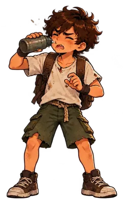

# 🏝️ O ÚLTIMO SOBREVIVENTE

### Dez dias. Uma ilha. Uma chance.

Um jogo de sobrevivência em que cada decisão pode fazer a diferença entre sobreviver e não conseguir sair da ilha.

🎮 **[JOGAR AGORA](https://juliabeatriz12.github.io/o-ultimo-sobrevivente/)**

---

## 📖 Sobre o jogo

Em *O Último Sobrevivente*, o jogador acompanha Rafael, que precisa enfrentar os desafios de uma ilha deserta durante dez dias.

Para conseguir sobreviver, será necessário administrar recursos, tomar decisões importantes e enfrentar acontecimentos inesperados.

Cada escolha possui consequências, e o jogador precisa pensar com cuidado antes de decidir o que fazer.

## 🎯 Objetivo

Sobreviver aos dez dias na ilha, administrar os recursos disponíveis e tomar decisões que aumentem as chances de conseguir escapar.

## 🎮 Como funciona

Durante a partida, o jogador precisa:

- Administrar a água e a comida.
- Coletar e utilizar madeira.
- Controlar a energia disponível.
- Fazer escolhas diante de diferentes situações.
- Enfrentar acontecimentos aleatórios.
- Preservar suas vidas até o final da jornada.

## 🧭 Recursos do jogo

| Recurso | Função |
|---|---|
| 💧 Água | Manter a hidratação |
| 🍎 Comida | Garantir alimentação |
| 🪵 Madeira | Recurso para a sobrevivência |
| ⚡ Energia | Administrar a disposição |
| ❤️ Vidas | Representam as chances restantes |

## 🌴 Funcionalidades

- Sistema de sobrevivência de dez dias.
- Decisões com consequências.
- Gerenciamento de recursos.
- Eventos aleatórios durante a jornada.
- Sistema de vidas.
- Condições de vitória e derrota.
- Possibilidade de iniciar uma nova partida.

## 💻 Tecnologias utilizadas

- HTML
- CSS
- JavaScript

O projeto funciona diretamente no navegador, sem precisar instalar programas adicionais para jogar.

## 🚀 Acesse o projeto

**Jogo:** https://juliabeatriz12.github.io/o-ultimo-sobrevivente/

**Repositório:** https://github.com/juliabeatriz12/o-ultimo-sobrevivente

---

## 📌 Considerações finais

O Último Sobrevivente é um projeto que trabalha com tomada de decisões, planejamento e gerenciamento de recursos por meio de uma experiência interativa de sobrevivência.

**Dez dias. Uma ilha. Uma chance de sobreviver.**
